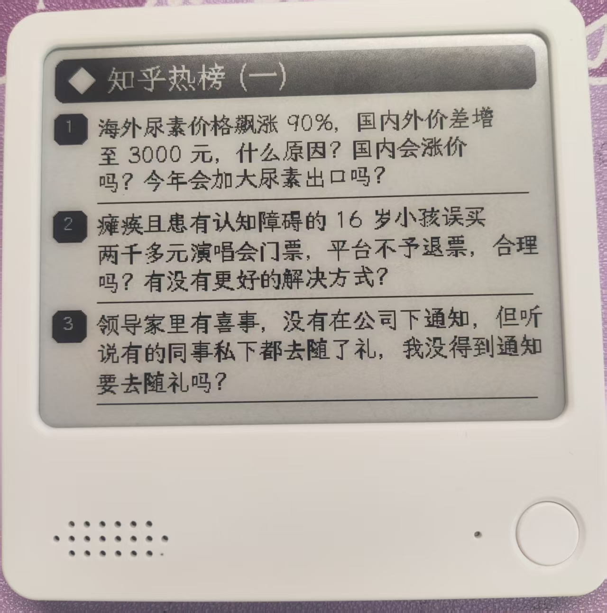
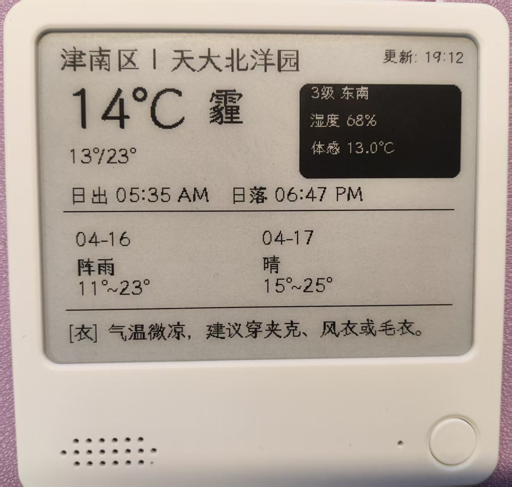

# 极趣墨水屏 NewsNow 风格看板

**⏱️ 复刻本项目仅需 5 分钟，即可快速拥有专属于你的桌面智能信息看板。**

这是一个专为极趣墨水屏 (Zectrix) 打造的自动化信息看板项目。

无需自行编写代码，只需按照下方步骤配置，即可让你的墨水屏实现全自动推送。完全免费，无需自建服务器。





---

## 📌 看板显示内容

本项目适配 400×300 分辨率墨水屏，共包含以下页面：

- **第 1、3 页：可配置信息页** – 每页可选择知乎、B站、GitHub 或任意 RSS/Atom 订阅。两个页面可以使用同一信息源，并自动连续分页。
- **第 2 页：NBA 看板** – 自动显示近三日赛程赛况：直播比分、下一场倒计时、今日赛果或休赛日回顾，并带 1 条新浪 NBA 中文热点。
- **第 4 页：综合天气** – 使用彩云天气数据，包含实时温湿度、体感温度、未来预报、日出日落、紫外线及舒适度。

---

## 🛠️ 部署指南

小白用户请依次按照以下 6 个步骤进行操作：

### 1. 复制项目 (Fork)
点击本页面右上角的 **`Fork`** 按钮，将本项目复制到你自己的 GitHub 账号下。

### 2. 更换字体(可选)
1. 项目默认使用 `resources/fonts/zfull-gb.ttf` 点阵字体，更适合 400×300 纯黑白墨水屏。
2. 如需更换字体，准备一个中文字体文件（后缀为 `.ttf`）上传到仓库，再把 `config.py` 中的 `DEFAULT_FONT_PATH` 指向它。

### 3. 配置隐私密钥 (Secrets)
由于涉及个人设备和 API 额度，需要将密钥配置在 GitHub 隐藏设置中。
1. 点击仓库顶部的 **`Settings`** 选项卡。
2. 在左侧菜单栏找到 **`Secrets and variables`**，点击展开后选择 **`Actions`**。
3. 点击 **`New repository secret`** 按钮，**分别添加**以下 3 个密钥：

| 填在 Name 里 | 填在 Secret 里 | 获取方式 |
|---|---|---|
| `ZECTRIX_API_KEY` | 你的极趣云 API Key | 登录 [极趣云控制台](https://cloud.zectrix.com) 获取 |
| `ZECTRIX_MAC` | 墨水屏 MAC 地址 | 格式如 `AA:BB:CC:DD:EE:FF` |
| `CAIYUN_API_TOKEN` | 彩云天气 API Token | 在彩云天气开放平台申请 |

### 4. 自定义城市与页面
你需要修改代码中的几个参数，把天气换成你所在的城市。
1. 在仓库首页，点击打开 **`config.py`** 文件。
2. 点击右上角的 ✏️ (编辑图标)。
3. 在代码顶部的**用户自定义区**，修改引号内的内容：
   - `PAGE_SOURCES`：配置第 1、3 页的信息源（第 2 页固定为 NBA 看板，不能配置信息源）。
   - `NBA_SCORE_SOURCE`：NBA 赛事数据源，默认 `espn`（免 key）；可改为 `official` 使用 NBA 官方 CDN。
   - `CAIYUN_LONGITUDE`：你所在位置的 GCJ-02 经度（高德坐标）。
   - `CAIYUN_LATITUDE`：你所在位置的 GCJ-02 纬度（高德坐标）。
   - `CITY_DISPLAY_NAME`：屏幕左上角显示的标题（如 `北京市 | 我的桌面`）。
   - `ENABLED_PAGES`：控制生成和推送哪些页面，例如只显示第 1、2、4 页时填写 `"1,2,4"`。
4. 修改完成后，点击右上角 **`Commit changes`** 保存。

`PAGE_SOURCES` 的默认配置如下：

```python
PAGE_SOURCES = {
    1: {"source": "github", "title": "GitHub 热门"},
    3: {"source": "zhihu", "title": "知乎热榜"},
}
```

第 1、3 页使用相同来源时，只请求一次数据，并分别显示连续的内容。

使用普通 RSS、Atom 或 RSSHub 地址时，将页面的 `source` 设置为 `rss`：

```python
PAGE_SOURCES = {
    1: {
        "source": "rss",
        "title": "我的技术资讯",
        "url": "https://example.com/feed.xml",
    },
    3: {"source": "github", "title": "GitHub 热门"},
}
```

同一个 RSS 地址配置到多个页面时也会自动连续分页。不同 RSS 地址会被视为不同的信息源。

### NBA 看板（第 2 页）

第 2 页固定为 NBA 单页看板，不需要额外配置或 API Key。每次运行会抓取北京时间昨天/今天/明天/后天的赛程，并按当前赛事状态切换主卡内容：

| 状态 | 触发条件 | 主卡内容 | 建议刷新 |
|---|---|---|---|
| `LIVE` | 今天有比赛正在进行 | 实时比分与节次/剩余时间 | 10 分钟 |
| `NEXT` | 今天没有直播，但还有未开赛比赛 | 两队对阵、北京时间与开赛倒计时 | 10/60 分钟 |
| `FINAL` | 今天比赛全部结束 | 今日赛果（最多 3 场） | 120 分钟 |
| `REST` | 今天没有比赛 | 最近比赛日赛果与下一场预告 | 720 分钟 |

- **赛事数据**：默认使用 ESPN 公开 scoreboard（免 key，可回查未来数日），并把每场比赛按**北京时间开赛日**重新分桶；设置 `NBA_SCORE_SOURCE=official` 可切换为 NBA 官方 CDN。
- **中文热点**：来自新浪 NBA 实时资讯接口，会过滤网球/足球等综合体育条目；接口不可用时回退到静态列表页，仍不可用时显示“暂无最新中文资讯”。
- **容错**：数据源失败会重试并回退到最近一次成功缓存，不会清空画面；第 2 页生成失败也不会影响第 1、3、4 页的推送。
- **缓存**：位于 `~/.cache/resoukanban-nba`，可用 `RESOUKANBAN_NBA_CACHE` 改到其它目录；GitHub Actions 上每次都是全新环境，缓存不会跨运行保留。

> **关于刷新频率**：本项目的 GitHub Actions 设置为每 2 小时运行一次，但 GitHub 的定时任务在高峰期经常延迟，实际间隔可能超过 2 小时。每次运行会打印 `NBA 状态: LIVE（建议 10 分钟后刷新）`，方便判断画面新鲜度。如果想在直播期间更及时，可以另建一个每 10 分钟触发、只生成第 2 页的 workflow（命令为 `python main.py --pages 2`），或在 Actions 页面手动 `Run workflow`。同时记得把设备的同步周期调到 10 分钟（极趣云支持 10/30/60/180/720 分钟），否则推送再频繁屏幕也不会刷新。

### 本地预览（推荐）

修改布局或增加页面时，可以先在本地生成图片，不推送到真实设备：

```bash
python3 -m pip install -r requirements.txt
python3 main.py --preview
```

生成的图片位于 `preview/` 目录。预览模式不需要配置
`ZECTRIX_API_KEY` 和 `ZECTRIX_MAC`，但天气页面仍需要
`CAIYUN_API_TOKEN` 才能获取真实天气数据；NBA 页面需要联网抓取赛程和新闻，
离线时会显示“今日暂无赛程”。

如需指定输出目录，或只预览某一页：

```bash
python3 main.py --preview --output-dir output
python3 main.py --preview --pages 2
```

### 代码结构

| 文件 | 职责 |
|---|---|
| `config.py` | 页面、城市、字体和密钥配置 |
| `data_sources.py` | 获取热榜、RSS/Atom 和天气数据 |
| `nba.py` | 抓取 NBA 赛程/赛况与中文热点，计算 LIVE/NEXT/FINAL/REST 状态 |
| `renderers.py` | 将数据绘制为 400×300 黑白图片 |
| `push.py` | 保存预览图或推送到极趣云 |
| `main.py` | 命令行入口和任务编排 |
| `assets/nba-logo.png` | 由 `assets/nba-script.svg` 预渲染的 NBA 字标（避免运行期依赖 CairoSVG） |

### 5. 修改推送频率 (可选)
默认情况下，系统每 2 小时自动推送一次（`run.yml` 中 `cron: '37 */2 * * *'`）。如需修改：
1. 进入仓库的 `.github/workflows/` 文件夹，点击编辑里面的 `.yml` 文件。
2. 找到 `cron: '37 */2 * * *'` 这一行进行修改。
3. **注意：此处使用的是 UTC 时间，比北京时间慢 8 小时。**
   - 每 2 小时更新一次：`cron: '0 */2 * * *'`
   - 每天早上 8 点更新一次（北京时间 8点 = UTC 0点）：`cron: '0 0 * * *'`
4. 修改后点击 **`Commit changes`** 保存。

> GitHub Actions 的定时任务在整点前后经常排队延迟，实际执行间隔可能明显长于设定值；对 NBA 比分有实时性要求时，请参考上面的「NBA 看板」小节。

### 6. 手动运行并激活
配置完成后，我们需要手动让它运行一次。
1. 点击仓库顶部的 **`Actions`** 选项卡。
2. 若弹出绿色提示框，请点击 **`I understand my workflows, go ahead and enable them`**。
3. 在左侧列表找到推送任务，点击选中它。
4. 点击右侧的 **`Run workflow`** 按钮，再点击弹出框中的确认按钮。

---

## 🚀 未来规划

本项目将持续迭代，计划增加以下功能：

1. 📈 **B 站粉丝看板**：增加专门的页面，实时显示 B 站粉丝数及动态。

---

## 💖 致谢
- 天气数据支持：彩云天气
- 信息源支持：[知乎](https://www.zhihu.com)、[Bilibili](https://www.bilibili.com)、[GitHub](https://github.com) 与 RSS/Atom
- NBA 数据：ESPN 公开 scoreboard、NBA 官方 Live CDN、新浪 NBA
- NBA 页面逻辑移植自 [zectrix-nba-board](https://github.com/happynailinzz/zectrix-nba-board)，感谢原作者
- 硬件及推送接口：[极趣云 Zectrix](https://cloud.zectrix.com)

---
如果觉得这个项目有用，欢迎给个 ⭐ 支持一下！
